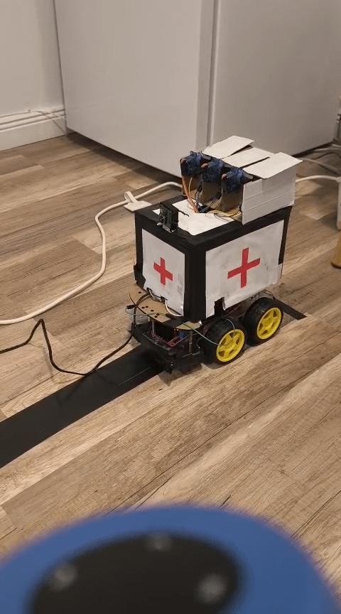
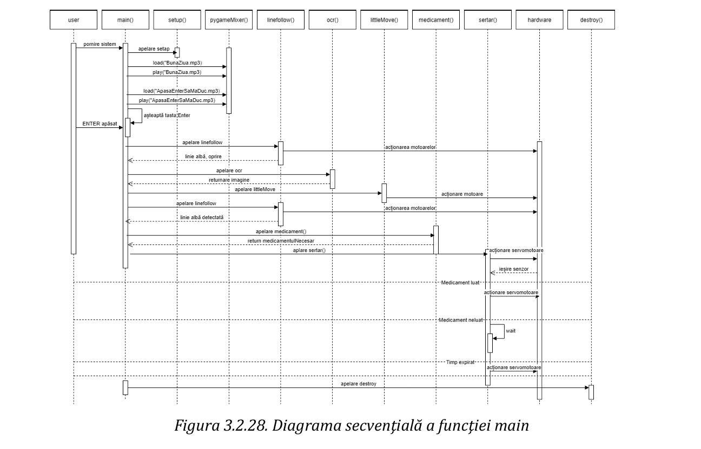
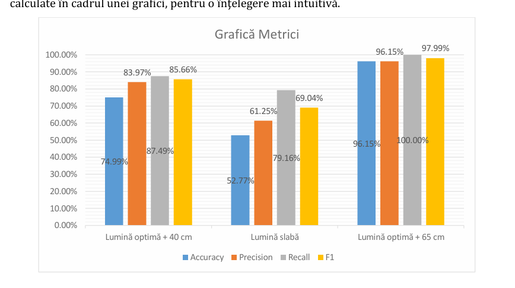

# 🤖 Autonomous Medical Assistive Robot

### Edge AI Prescription Extraction & Real-Time Embedded Mobile Actuation

> **An autonomous mobile healthcare robot engineered to bridge digital document perception with physical mechatronic delivery.**
>
> Powered by an embedded Linux single-board computer, the platform integrates real-time optical tracking, hardware autofocus document capture, on-device Python-based OCR inference, and secure, sensor-validated servo medicine dispensing.

---

## 📌 Executive Overview

In hospital wards and clinical care environments, manual medication distribution consumes significant nursing bandwidth and introduces risks of dispatch latency.

This project delivers an **end-to-end edge-computed logistics solution**:

1. **Autonomous Route Navigation:** Traverses ward floors using a multi-channel IR optical array and closed-loop motor feedback.
2. **Contactless Medical Prescription OCR:** Halts at patient chart stations, triggers dynamic hardware autofocus, extracts drug names using adaptive OpenCV filters, and maps targets to verified medication databases via Tesseract.
3. **Physical Validation & Actuation:** Travels to patient coordinates, opens individual servo-latched compartments, and confirms physical retrieval via internal drawer optocouplers before executing a secure latch timeout.

---

## 🎥 Physical System Demonstration

### Quick Workflow Preview



> 📹 **Full Operational Demonstration (1-Minute Video):**  
> Watch the complete mission workflow from voice greeting to navigation, autonomous chart scanning, and compartment delivery:  
> 🔗 **[Watch Full Video Demonstration (docs/demo_full.mp4)](docs/demo_full.mp4)**  
> *(You can also view the high-definition recording directly in the repository media attachments).*

---

## ⚙️ System Architecture & Workflow

The platform operates on a deterministic, event-driven state machine orchestrated entirely in Python. Each cycle coordinates low-level hardware timers, GPIO interfaces, vision capture threads, and human-machine audio alerts.

```
+---------------------------------------------------------------------------------------------------+
|                                  MAIN CONTROL ORCHESTRATOR                                        |
+---------------------------------------------------------------------------------------------------+
       |                                      |                                      |
       v                                      v                                      v
 [ NAV SUBSYSTEM ]                    [ VISION ENGINE ]                    [ DISPENSE SUBSYSTEM ]
 - 3-Ch IR Optical Sensors            - PiCamera2 (Hardware AF)            - Multi-channel Servos (PWM)
 - 4x DC Motors (H-Bridge PWM)        - CLAHE & Otsu Morphology            - Compartment IR Interrupters
 - Checkpoint Line Detection          - Tesseract OCR Extraction           - Pygame Voice Prompts
```

### Complete Sequence Workflow Diagram



1. **Initialization:** Hardware bring-up, PWM channel calibration, and welcome voice prompt.
2. **Stage 1 (Navigation):** Autonomous optical line tracking toward the medical chart checkpoint.
3. **Stage 2 (Edge Vision):** Image capture, noise reduction, grid contour extraction, and OCR execution.
4. **Stage 3 (Decision & Navigation):** Parsing extracted text against prescription dictionaries and advancing to the patient delivery point.
5. **Stage 4 (Actuation & Validation):** Opening the designated servo compartment, monitoring the drawer sensor for physical retrieval, and executing timed auto-close routines.

---

## 🔬 Benchmark & Empirical Validation

To guarantee clinical safety and minimize false-negative medication dispatch, the on-device perception pipeline was benchmarked under varying ambient illumination and optical focal distances ($40\text{ cm}$ vs. $65\text{ cm}$).



### 📊 Performance Summary Table

| Test # | Target Drug | Illumination Profile | Working Distance | Accuracy | Precision | Recall | F1-Score | Status |
| :---: | :---: | :---: | :---: | :---: | :---: | :---: | :---: | :---: |
| **01** | `Paracetamol` | Optimal Ambient | $40\text{ cm}$ | 78.57% | 84.61% | 91.66% | **87.99%** | Passed |
| **02** | `Paracetamol` | Low Light (< 100 lx) | $40\text{ cm}$ | 50.00% | 60.00% | 75.00% | **66.66%** | Degraded |
| **03** | `Paracetamol` | Optimal Ambient | $65\text{ cm}$ | 92.30% | 92.30% | 100.00% | **95.99%** | **Optimal** |
| **04** | `Nurofen` | Optimal Ambient | $40\text{ cm}$ | 71.42% | 83.33% | 83.33% | **83.33%** | Passed |
| **05** | `Nurofen` | Low Light (< 100 lx) | $40\text{ cm}$ | 55.55% | 62.50% | 83.33% | **71.42%** | Degraded |
| **06** | `Nurofen` | Optimal Ambient | $65\text{ cm}$ | 100.00% | 100.00% | 100.00% | **100.00%** | **Peak** |

> 📁 *The complete raw data sheets, confusion matrices, and analytical formulas are available in [`tests/Edge_OCR_Benchmark_Analysis.xlsx`](tests/Edge_OCR_Benchmark_Analysis.xlsx).*

---

## 🛠️ Hardware & Pin Configuration

| Subsystem | Component | Interface / Protocol | Pin Mapping (BCM) | Function |
| --- | --- | --- | --- | --- |
| **Compute** | Raspberry Pi 4 | SoC / Embedded Linux | — | Central Controller & Pipeline Orchestration |
| **Mobility** | 4x DC Motors | Dual H-Bridge Drivers | `GPIO 27, 17, 22, 6, 5, 13, 19, 26, 12, 24, 23, 25` | Directional logic & PWM speed control |
| **Sensors** | 3-Channel Optical Array | Digital Input | `GPIO 16, 4, 18` | Differential closed-loop line following |
| **Dispensing** | Micro Servos | Software PWM (50 Hz) | `GPIO 20, 8, 14` | Mechanical drawer latch control |
| **Verification**| Drawer State Sensors | Digital Input (Internal Pull-Up) | `GPIO 15, 10, 9` | Detects physical drug container removal |
| **Perception** | PiCamera2 Module | MIPI-CSI | Dedicated CSI Port | High-resolution image capture with hardware autofocus |

---

## 📂 Repository Structure

```text
├── assets/
│   └── audio/                      # Audio prompts directory (.mp3 voice notifications)
│                                   # Place BunaZiua.mp3, SertarulSaDeschis.mp3 etc. here
├── docs/
│   ├── demo.gif                    # Fast animated demonstration preview
│   ├── demo_full.mp4               # Complete 1-minute system run recording
│   ├── sequence_diagram.png        # Complete system sequence workflow diagram
│   └── ocr_benchmark_chart.png     # Validation metrics bar chart
├── src/
│   ├── config.py                   # Pinout mappings and PWM timing parameters
│   ├── motor_control.py            # DC motor driver and line-tracking loop
│   ├── compartment.py              # Servo actuation, drawer sensors & audio handling
│   ├── vision.py                   # Camera capture, image filters & OCR pipeline
│   └── main.py                     # Main operational state orchestrator
├── tests/
│   └── Edge_OCR_Benchmark_Analysis.xlsx # Empirical test dataset & analysis workbook
├── requirements.txt
└── README.md
```

> ℹ️ **Audio Assets Note:** The voice alert clips (`.mp3`) belong in `assets/audio/`. If files are absent, the audio subsystem gracefully falls back to silent operation without impeding navigation or motor routines.

---

## 🚀 Installation & Setup

1. **Clone the repository:**
   ```bash
   git clone https://github.com/BajkoKitti/autonomous-medical-assistant-robot.git
   cd autonomous-medical-assistant-robot
   ```

2. **Install system dependencies (Embedded Linux / Raspberry Pi OS):**
   ```bash
   sudo apt update
   sudo apt install tesseract-ocr libtesseract-dev -y
   ```

3. **Install Python dependencies:**
   ```bash
   pip install -r requirements.txt
   ```

4. **Launch system:**
   ```bash
   python src/main.py
   ```

---

## 📜 License

This project is licensed under the MIT License - see the [LICENSE](LICENSE) file for details.
